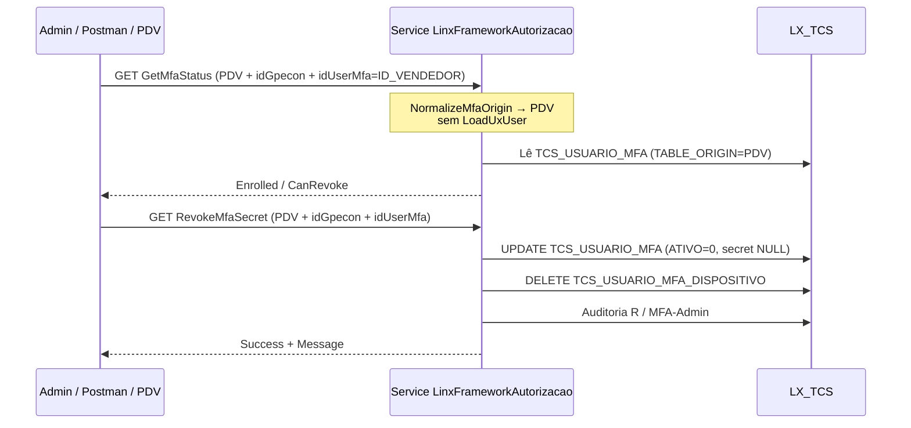

# Revogar MFA PDV (`RevokeMfaSecret` — `tableOrigin=PDV`)

Documentação do endpoint de **revogação do secret MFA** para **vendedor** (PDV / `LJV_VENDEDOR`).

| Artefato | Caminho |
|----------|---------|
| Collection Postman (PDV) | [postman/Linx-PDV-RevokeMfaSecret.postman_collection.json](postman/Linx-PDV-RevokeMfaSecret.postman_collection.json) |
| Mesmo endpoint — fluxo UX | [revoke-mfa-secret.md](revoke-mfa-secret.md) |
| Guia geral de APIs MFA/SSO | [login-mfa-sso-api.md](login-mfa-sso-api.md) |
| Estórias / escopo de entrega | [estorias-construcao-mfa.md](estorias-construcao-mfa.md) |

**Importante:** o método HTTP é **`GET`** (querystring), igual às demais APIs MFA do Service — não é `POST`.

**Escopo de produto:** a API e o schema já aceitam `PDV`. Nesta entrega **não há** tela “Revogar MFA” no cadastro de vendedor (`LojaVendedor`). Este guia serve para integração / Postman / PDV futuro.

---

## 1. Explicação para usuários (alto nível)

### O que é “revogar MFA” no PDV?

É a ação (admin / suporte / integração) que **apaga o autenticador já cadastrado** de um **vendedor** (`LJV_VENDEDOR`), não de um usuário de Portal/Application (`TCS_USUARIO_AUTENTICACAO`).

### Diferença em relação ao UX

| | UX (Portal / Application) | PDV (vendedor) |
|--|---------------------------|----------------|
| Cadastro | `TCS_USUARIO_AUTENTICACAO` | `LJV_VENDEDOR` |
| `tableOrigin` | `UX` | **`PDV`** (alias `LJV_VENDEDOR`) |
| Identificador | Guid `uidUsuario` → resolve `ID_USUARIO` | **`idUserMfa` = `ID_VENDEDOR`** (numérico) |
| `idGpecon=0` | Pode: Service resolve pelo cadastro UX | **Não:** informe o GPECON explícito |
| UI nesta entrega | Botão Revogar MFA no cadastro de usuário | **Sem tela** — só API |

### Quando usar

- Vendedor perdeu o celular / autenticador.
- QR cadastrado errado no PDV.
- Suporte precisa forçar novo cadastro MFA no próximo acesso do vendedor.

### O que acontece depois

1. O secret antigo daquele vendedor (origem `PDV`) deixa de valer.
2. Dispositivos “lembrados” daquele MFA PDV são limpos.
3. No próximo acesso PDV com MFA exigido, o fluxo pede **novo QR**.
4. Isso **não** mexe no MFA do usuário UX, nem na senha do vendedor em outras bases, nem em SSO do Portal.

---

## 2. Explicação técnica

### 2.1 Onde vive

| Camada | Peça |
|--------|------|
| WebAPI | `LinxFrameworkAutorizacaoController.RevokeMfaSecret` |
| Domínio | `AutorizacaoDomainService.RevokeMfaSecret` (`Autorizacao.Mfa.Operations.cs`) |
| Normalização | `NormalizeMfaOrigin`: `LJV_VENDEDOR` / `PDV` → origem gravada **`PDV`** |
| Banco MFA | `LX_TCS.TCS_USUARIO_MFA` + `LX_TCS.TCS_USUARIO_MFA_DISPOSITIVO` |
| Cadastro vendedor | `LJV_VENDEDOR.ID_VENDEDOR` → valor de `ID_USER_MFA` |

Rota (igual ao UX; muda só a query):

```http
GET {ServiceUrl}/LinxFrameworkAutorizacao/RevokeMfaSecret
```

### 2.2 Parâmetros (querystring)

| Parâmetro | Tipo | Obrigatório (PDV) | Descrição |
|-----------|------|-------------------|-----------|
| `tableOrigin` | string | Sim | Use **`PDV`** ou alias **`LJV_VENDEDOR`**. |
| `idGpecon` | int | Sim (explícito) | `TCS_EMPRESA_AUTENTICACAO.ID_LINX`. **Não** use `0` esperando auto-resolve: `LoadUxUser` não roda para origem PDV. |
| `idUserMfa` | long | Sim | **`LJV_VENDEDOR.ID_VENDEDOR`**. |
| `uidUsuario` | Guid | Não usar | Ignorado / sem resolução para PDV. Deixe vazio ou omita. |

Chave lógica no banco: `(TABLE_ORIGIN='PDV', ID_GPCON, ID_USER_MFA=ID_VENDEDOR)`.

Não misture com UX: o mesmo número de `ID_USUARIO` UX **não** é o `ID_VENDEDOR`, e mesmo que coincidisse o `TABLE_ORIGIN` separa os secrets.

### 2.3 Headers

Mesmos headers de sessão do Service (quando o authorize estiver ativo):

| Header | Origem |
|--------|--------|
| `AuthorizationToken` | Token da sessão |
| `CurrentUser` | Id do usuário logado |
| `Environment` | Ambiente |
| `Application` | Aplicação |
| `CurrentCompany` | Empresa |
| `AccessGroup` | Grupo de acesso |
| `EconomicGroup` | GPECON da sessão |
| `SessionID` | Sessão |

### 2.4 Comportamento no servidor

Igual ao UX após resolver a chave:

1. `GetMfaStatus` com origem normalizada `PDV`.
2. Se `IdUserMfa <= 0` → `Success=false`, *“Usuário MFA não informado.”*
3. `UPDATE TCS_USUARIO_MFA` (`ATIVO=0`, `ACCESS_SECRET=NULL`, limpa lockout) onde `TABLE_ORIGIN=PDV`.
4. `DELETE` em `TCS_USUARIO_MFA_DISPOSITIVO` da mesma chave.
5. Auditoria **`R`** / canal **`MFA-Admin`**.
6. `Success=true` + mensagem de novo QR.

A API **não** exige `CanRevoke=true` no servidor — consulte `GetMfaStatus` antes.

### 2.5 Resposta JSON (`MfaValidateResult`)

Igual ao UX:

```json
{
  "Success": true,
  "Message": "MFA revogado. O usuário cadastrará um novo QR no próximo acesso.",
  "Ticket": null,
  "TicketExpiresUtc": null,
  "MfaLocked": false
}
```

### 2.6 Endpoint irmão: `GetMfaStatus`

```http
GET {ServiceUrl}/LinxFrameworkAutorizacao/GetMfaStatus?tableOrigin=PDV&idGpecon={idLinx}&idUserMfa={idVendedor}
```

| Campo | Uso |
|-------|-----|
| `TableOrigin` | Deve voltar `PDV` |
| `IdUserMfa` | `ID_VENDEDOR` informado |
| `IdGpecon` | GPECON informado |
| `Enrolled` / `CanRevoke` | Tem secret ativo? |
| `UidUsuario` / `NomeAutenticacao` | Em geral vazios no PDV (sem `LoadUxUser`) |

### 2.7 Exemplo curl

```bash
# 1) Status do vendedor
curl -sG "http://localhost:1710/LinxFrameworkAutorizacao/GetMfaStatus" \
  --data-urlencode "tableOrigin=PDV" \
  --data-urlencode "idGpecon=123" \
  --data-urlencode "idUserMfa=456" \
  -H "AuthorizationToken: <token>" \
  -H "CurrentUser: <id>" \
  -H "Environment: <idAmbiente>"

# 2) Revogar
curl -sG "http://localhost:1710/LinxFrameworkAutorizacao/RevokeMfaSecret" \
  --data-urlencode "tableOrigin=PDV" \
  --data-urlencode "idGpecon=123" \
  --data-urlencode "idUserMfa=456" \
  -H "AuthorizationToken: <token>" \
  -H "CurrentUser: <id>" \
  -H "Environment: <idAmbiente>"
```

Alias equivalente: `tableOrigin=LJV_VENDEDOR` (o Service grava/consulta como `PDV`).

### 2.8 Fluxo (visão)



### 2.9 Como achar `idUserMfa` e `idGpecon`

```sql
-- Vendedor
SELECT ID_VENDEDOR, COD_VENDEDOR, NOME_VENDEDOR, ID_LOJA
FROM dbo.LJV_VENDEDOR   -- schema/nome conforme o banco do cliente
WHERE COD_VENDEDOR = '...';

-- GPECON (ID_LINX) da empresa do ambiente — o mesmo usado nas APIs MFA UX
SELECT ID_LINX, NOME_EMPRESA
FROM [LX_TCS].[TCS_EMPRESA_AUTENTICACAO]
WHERE ID_LINX = @idGpecon;

-- Conferir secret MFA já gravado para o vendedor
SELECT *
FROM [LX_TCS].[TCS_USUARIO_MFA]
WHERE TABLE_ORIGIN = N'PDV'
  AND ID_GPCON = @idGpecon
  AND ID_USER_MFA = @idVendedor;
```

---

## 3. Collection Postman

Arquivo: [postman/Linx-PDV-RevokeMfaSecret.postman_collection.json](postman/Linx-PDV-RevokeMfaSecret.postman_collection.json)

### Como importar

1. Postman → **Import** → JSON.
2. Variables:
   - `serviceUrl` — ex. `http://localhost:1710`
   - `tableOrigin` — `PDV` (ou `LJV_VENDEDOR`)
   - `idGpecon` — **obrigatório** (não deixe `0` sem saber o valor real)
   - `idUserMfa` — **`ID_VENDEDOR`**
   - headers de sessão
3. Pasta **Admin MFA PDV**: status → revogar → status.

---

## 4. Checklist rápido

- [ ] `tableOrigin=PDV` (ou `LJV_VENDEDOR`)  
- [ ] `idUserMfa` = `LJV_VENDEDOR.ID_VENDEDOR` (não Guid UX)  
- [ ] `idGpecon` explícito e correto  
- [ ] Não reutilizar collection UX com `uidUsuario` para vendedor  
- [ ] `GetMfaStatus` com `Enrolled=true` antes de revogar  
- [ ] Confirmar que a linha MFA no SQL usa `TABLE_ORIGIN='PDV'`  
- [ ] Saber que **não há** botão Revogar MFA na UI de vendedor nesta entrega  
