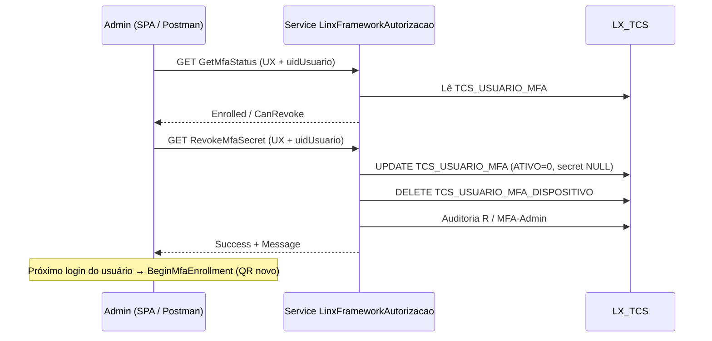

# Revogar MFA (`RevokeMfaSecret`)

Documentação do endpoint de **revogação do secret MFA** (TOTP Linx UX).

| Artefato | Caminho |
|----------|---------|
| Collection Postman | [postman/Linx-UX-RevokeMfaSecret.postman_collection.json](postman/Linx-UX-RevokeMfaSecret.postman_collection.json) |
| Guia geral de APIs MFA/SSO | [login-mfa-sso-api.md](login-mfa-sso-api.md) |
| Texto geral para usuário | [login-mfa-sso-usuario.md](login-mfa-sso-usuario.md) |

**Importante:** o método HTTP é **`GET`** (querystring), igual às demais APIs MFA do Service — não é `POST`.

---

## 1. Explicação para usuários (alto nível)

### O que é “revogar MFA”?

É a ação do **administrador** que **apaga o aplicativo autenticador já cadastrado** de um usuário (o QR / secret do Google Authenticator, Microsoft Authenticator, etc.).

Não desliga a política de MFA da empresa. Só remove o cadastro daquele usuário.

### Quando usar

- A pessoa **perdeu o celular** ou o autenticador.
- O QR foi cadastrado **errado** e o código nunca fecha.
- Suporte precisa **forçar um novo cadastro** de MFA no próximo login.

### O que acontece depois

1. O secret antigo deixa de valer.
2. Dispositivos “lembrados” daquele MFA também são limpos.
3. No **próximo acesso**, se a empresa e o usuário ainda exigirem MFA, o Portal mostra de novo o **QR Code** para cadastrar.
4. A **senha** Linx e o **vínculo Microsoft (SSO)** **não** mudam. Revogar MFA ≠ revogar SSO.

### Como fazer na tela (Application)

1. Abra o cadastro de usuário (Usuário / Autenticação / Local, conforme o menu do seu ambiente).
2. Selecione o usuário.
3. Use o botão **Revogar MFA** (fica ao lado de **Revogar SSO**).
4. Confirme a mensagem: *“Revogar o MFA deste usuário? No próximo acesso ele cadastrará um novo QR Code.”*
5. Se não houver MFA cadastrado, o sistema avisa: *“Não há MFA cadastrado para revogar.”*

### O que isso **não** faz

- Não desmarca “Utiliza MFA” no cadastro (isso é outra ação / flag).
- Não desliga MFA da empresa (GPECON).
- Não troca senha nem remove login Microsoft.

---

## 2. Explicação técnica

### 2.1 Onde vive

| Camada | Peça |
|--------|------|
| UI | SPA `CadastroUsuario*.js` → `revokeMfa()` → `GET .../RevokeMfaSecret` |
| WebAPI | `LinxFrameworkAutorizacaoController.RevokeMfaSecret` (`LinxFrameworkAutorizacao.cs`) |
| Domínio | `AutorizacaoDomainService.RevokeMfaSecret` (`Autorizacao.Mfa.Operations.cs`) |
| Banco | `LX_TCS.TCS_USUARIO_MFA` + `LX_TCS.TCS_USUARIO_MFA_DISPOSITIVO` |

Base do Service: `{ServiceUrl}` — QA típico `http://<host>:1710/` (ou a porta HTTPS do ambiente).

Rota completa:

```http
GET {ServiceUrl}/LinxFrameworkAutorizacao/RevokeMfaSecret
```

### 2.2 Parâmetros (querystring)

| Parâmetro | Tipo | Obrigatório | Descrição |
|-----------|------|-------------|-----------|
| `tableOrigin` | string | Sim | No UX use **`UX`**. |
| `idGpecon` | int | Sim na assinatura | Pode ser **`0`**: com `uidUsuario`, o Service resolve `ID_LINX_GPECON` do cadastro. |
| `uidUsuario` | Guid | Recomendado (UX) | `TCS_USUARIO_AUTENTICACAO.UID_USUARIO`. Preferido pela UI. |
| `idUserMfa` | long | Alternativa | `ID_USUARIO` (UX). Opcional se `uidUsuario` vier preenchido. |

Chave lógica do MFA no banco: `(TABLE_ORIGIN, ID_GPCON, ID_USER_MFA)`.

### 2.3 Headers (como a SPA chama)

A UI envia os headers de sessão do Application (`managerAuth.getHeaders(...)`), tipicamente:

| Header | Origem |
|--------|--------|
| `AuthorizationToken` | Token da sessão |
| `CurrentUser` | Id do usuário logado |
| `Environment` | Ambiente (`IdTcsAmbiente`) |
| `Application` | Aplicação |
| `CurrentCompany` | Empresa |
| `AccessGroup` | Grupo de acesso |
| `EconomicGroup` | GPECON da sessão |
| `SessionID` | Sessão |

No Postman, preencha pelo menos `AuthorizationToken` / `CurrentUser` / `Environment` com valores de uma sessão válida do Application. Em ambientes de QA onde o authorize do Service ainda está permissivo, a chamada pode responder sem auth forte — **não trate isso como comportamento de produção desejado**.

### 2.4 Comportamento no servidor

1. Chama `GetMfaStatus` para resolver origem, GPECON e `idUserMfa`.
2. Se `IdUserMfa <= 0` → `Success=false`, mensagem *“Usuário MFA não informado.”*
3. `UPDATE TCS_USUARIO_MFA`  
   `ATIVO=0`, `ACCESS_SECRET=NULL`, zera tentativas TOTP e bloqueio.
4. `DELETE` em `TCS_USUARIO_MFA_DISPOSITIVO` daquele usuário/origem/GPECON.
5. Auditoria MFA: evento **`R`**, canal **`MFA-Admin`**, texto *“Revogação de ACCESS_SECRET MFA”*.
6. Retorna `Success=true` e mensagem de novo QR no próximo acesso.

**Observação:** a API **não** exige `CanRevoke=true` no servidor. A UI SPA é que bloqueia o clique quando `GetMfaStatus.CanRevoke` é falso (`Enrolled=false`). Chamar a API sem enrollment ainda pode retornar sucesso após o UPDATE (0 linhas) — por isso o fluxo recomendado é **consultar status antes**.

### 2.5 Resposta JSON (`MfaValidateResult`)

| Campo | Tipo | Revogar MFA |
|-------|------|-------------|
| `Success` | bool | `true` / `false` |
| `Message` | string | Mensagem amigável |
| `Ticket` | string | Normalmente `null` (não emite ticket) |
| `TicketExpiresUtc` | DateTime? | Normalmente `null` |
| `MfaLocked` | bool | Normalmente `false` |

Exemplo de sucesso:

```json
{
  "Success": true,
  "Message": "MFA revogado. O usuário cadastrará um novo QR no próximo acesso.",
  "Ticket": null,
  "TicketExpiresUtc": null,
  "MfaLocked": false
}
```

Exemplo de falha (sem usuário resolvido):

```json
{
  "Success": false,
  "Message": "Usuário MFA não informado.",
  "Ticket": null,
  "TicketExpiresUtc": null,
  "MfaLocked": false
}
```

### 2.6 Endpoint irmão: conferir antes (`GetMfaStatus`)

```http
GET {ServiceUrl}/LinxFrameworkAutorizacao/GetMfaStatus?tableOrigin=UX&idGpecon=0&uidUsuario={guid}
```

Campos úteis:

| Campo | Uso na revogação |
|-------|------------------|
| `Enrolled` | Tem secret ativo? |
| `CanRevoke` | UI habilita o botão (`== Enrolled`) |
| `RequiresMfa` | Ainda vai pedir MFA no próximo login? |
| `IdUserMfa` / `IdGpecon` | Identificadores resolvidos |
| `SkipReason` | Por que MFA seria pulado |

### 2.7 Exemplo curl

```bash
# 1) Status
curl -sG "http://localhost:1710/LinxFrameworkAutorizacao/GetMfaStatus" \
  --data-urlencode "tableOrigin=UX" \
  --data-urlencode "idGpecon=0" \
  --data-urlencode "uidUsuario=00000000-0000-0000-0000-000000000000" \
  -H "AuthorizationToken: <token>" \
  -H "CurrentUser: <id>" \
  -H "Environment: <idAmbiente>"

# 2) Revogar
curl -sG "http://localhost:1710/LinxFrameworkAutorizacao/RevokeMfaSecret" \
  --data-urlencode "tableOrigin=UX" \
  --data-urlencode "idGpecon=0" \
  --data-urlencode "uidUsuario=00000000-0000-0000-0000-000000000000" \
  -H "AuthorizationToken: <token>" \
  -H "CurrentUser: <id>" \
  -H "Environment: <idAmbiente>"
```

### 2.8 Fluxo (visão)



---

## 3. Collection Postman

Arquivo: [postman/Linx-UX-RevokeMfaSecret.postman_collection.json](postman/Linx-UX-RevokeMfaSecret.postman_collection.json)

### Como importar

1. Abra o Postman → **Import** → selecione o JSON.
2. Na collection, abra **Variables** e preencha:
   - `serviceUrl` — ex. `http://localhost:1710` ou a URL do Service no AWS
   - `uidUsuario` — GUID do usuário alvo
   - `idGpecon` — `0` (resolve pelo cadastro) ou o GPECON explícito
   - `tableOrigin` — `UX`
   - headers de sessão (`authorizationToken`, `currentUser`, `environment`, etc.)
3. Rode na ordem da pasta **Admin MFA**:
   1. `GetMfaStatus`
   2. `RevokeMfaSecret`
   3. `GetMfaStatus` (de novo) — espere `Enrolled=false` / `CanRevoke=false`

---

## 4. Checklist rápido

- [ ] `tableOrigin=UX` no delivery atual  
- [ ] `uidUsuario` válido (não Guid vazio)  
- [ ] Confirmar `CanRevoke=true` antes de revogar (UI ou `GetMfaStatus`)  
- [ ] Após revogar, próximo login com MFA exigido → QR novo  
- [ ] SSO / senha intactos  
